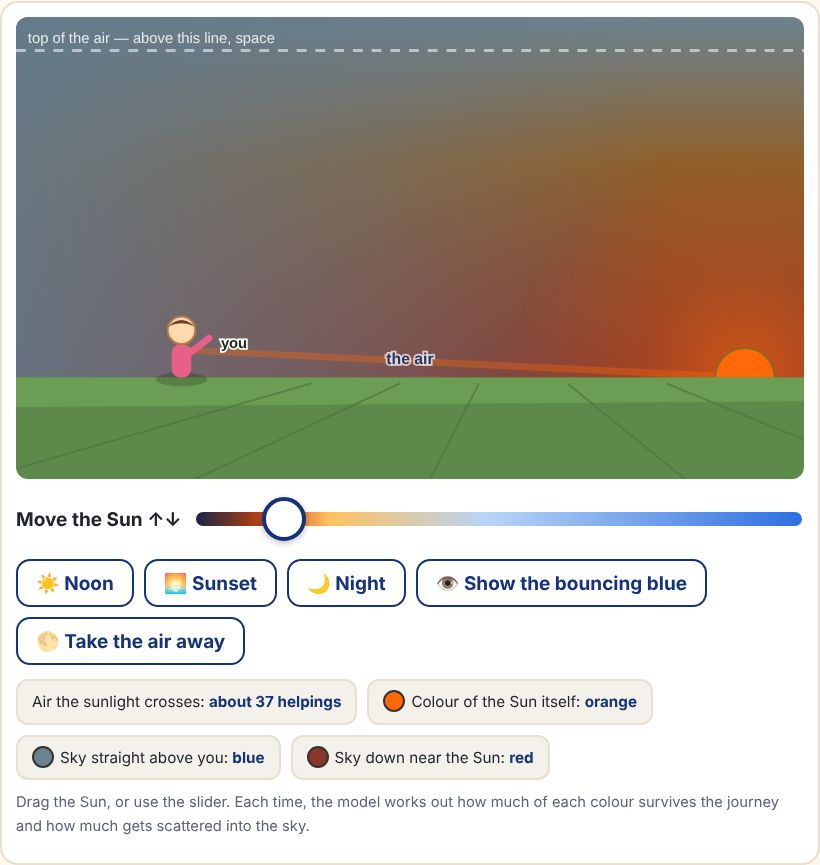
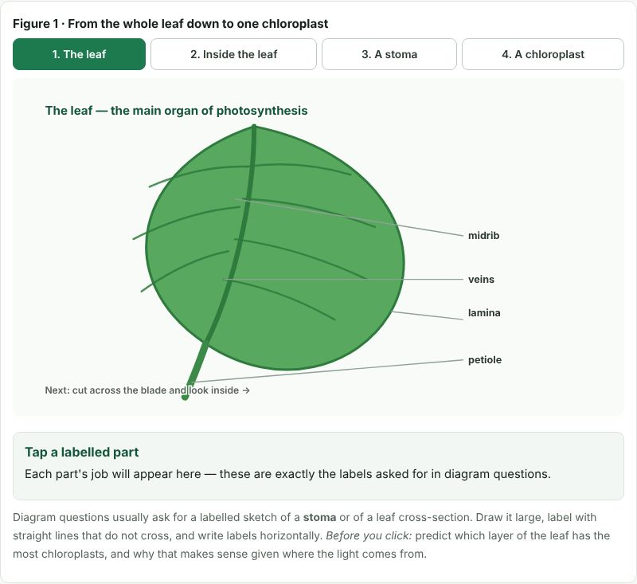
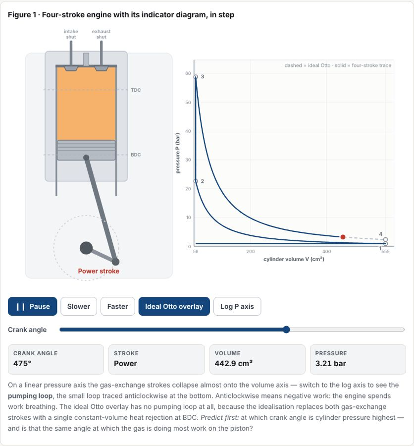
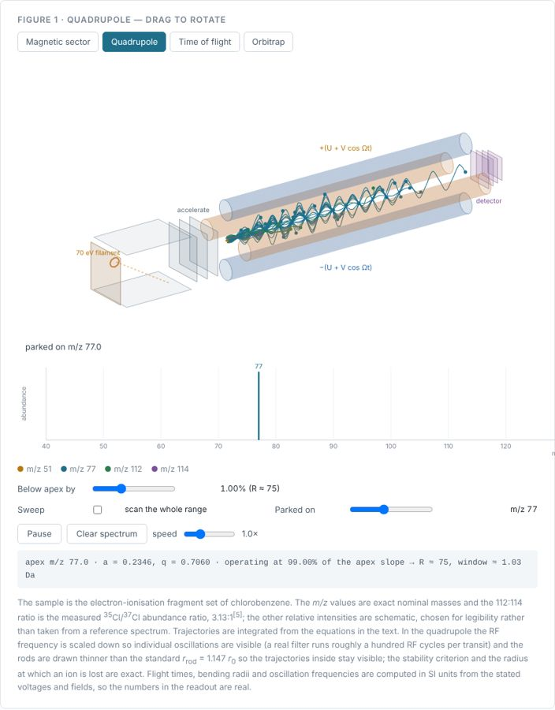
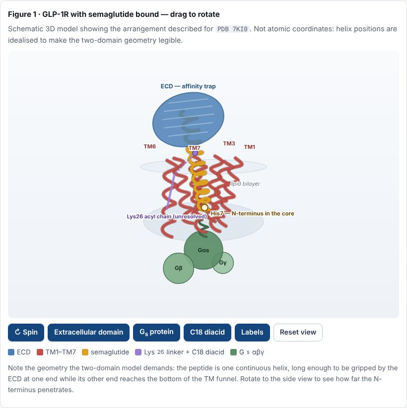
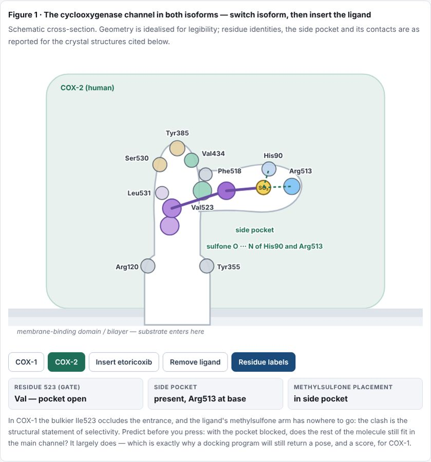
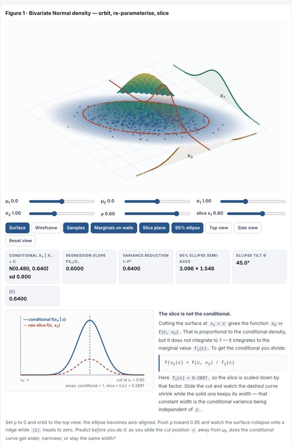

<div align="center">

# 🧊 learn3d-sim

### Science notes you can play with

**A Claude skill that turns any topic into evidence-based study notes with interactive 3D simulations,
questions with model answers, and many ways to learn, pitched exactly at the reader:
from a curious child to a PhD researcher.**

[**▶ Live example gallery**](https://mahanteshmentos-mantu.github.io/learn3d-sim/) ·
[Install](#-install-in-2-minutes) ·
[What you can ask](#-what-you-can-ask) ·
[How it teaches](#-how-it-teaches) ·
[Contribute](CONTRIBUTING.md)


</div>

---

## ✨ Seven real examples, one skill

Every page below came from **one plain-language request**. Each is a single offline file:
open it, drag the 3D figure, press the buttons, answer the questions.

| | Example | Reader | You get to... |
|---|---|---|---|
|  | [**Why is the sky blue?**](https://mahanteshmentos-mantu.github.io/learn3d-sim/examples/why-is-the-sky-blue.html) | 🧒 Children, curious minds | Drag the Sun through a sky that does real Rayleigh-scattering sums: noon, sunset, night, "take the air away" |
|  | [**Photosynthesis: Class 10 exam notes**](https://mahanteshmentos-mantu.github.io/learn3d-sim/examples/photosynthesis-class10.html) | 🎒 School (CBSE) | Zoom leaf → stoma → chloroplast, tap each part, practise board-style questions with marking notes |
|  | [**The four-stroke engine and the Otto cycle**](https://mahanteshmentos-mantu.github.io/learn3d-sim/examples/four-stroke-engine.html) | ⚙️ Engineering undergrad | Run an engine in step with its live P–V diagram; derive η = 1 − r<sup>1−γ</sup>; see where 60% becomes 40% |
|  | [**How a mass spectrometer works**](https://mahanteshmentos-mantu.github.io/learn3d-sim/examples/mass-spectrometer/index.html) | 🧪 Postgraduate | Switch between sector, quadrupole (exact Mathieu stability), TOF + reflectron and Orbitrap with a live Fourier transform |
|  | [**How semaglutide binds the GLP-1 receptor**](https://mahanteshmentos-mantu.github.io/learn3d-sim/examples/semaglutide-glp1r.html) | 💊 Pharmacology PG | Rotate a model of PDB 7KI0, read the residue contacts, learn why each modification exists and what is still contested |
|  | [**Comparative docking: etoricoxib vs COX-1/COX-2**](https://mahanteshmentos-mantu.github.io/learn3d-sim/examples/etoricoxib-cox-docking.html) | 🔬 PhD research | Dock the ligand into each isoform, follow a reproducible Vina protocol, learn what a score can and cannot claim |
|  | [**The bivariate Normal surface**](https://mahanteshmentos-mantu.github.io/learn3d-sim/examples/bivariate-normal.html) | 📐 Maths, research level | Orbit the density, change Σ, slice it, and see why a slice is not a conditional |

> Live links work once GitHub Pages is on for this repo (Settings → Pages → *Deploy from branch* → `main` / `docs`).
> Until then, open any file in [`docs/examples/`](docs/examples) after downloading.

---

## 🎯 What makes it different

| | |
|---|---|
| 📚 **Evidence first** | Every number and named fact traces to a source the skill read. References are graded (**A** primary or standard text, **B** review, **C** documentation), and what is contested is labelled as contested. |
| 🪜 **The right register for the reader** | A child gets short spoken sentences and a game. A graduate gets standard scientific prose: precise headings, the field's nomenclature, numbered equations, sourced constants. A PhD reader also gets *how we know* and *what is still debated*. |
| 🧊 **3D that does the science** | Figures are driven by the real equations (Mathieu stability, slider-crank kinematics, Rayleigh scattering, Cholesky sampling), not drawn by hand. Rotate, slice, switch isoforms, press Play. |
| 🎯 **Predict, then check** | Every figure carries a *Try this* prompt that asks for a prediction before the learner presses anything, the single most effective habit in active learning. |
| ❓ **Questions with model answers** | Self-tests, exam-style questions with marking notes, case-based questions and "what's wrong with this claim?" critiques at research level. |
| 🔀 **Many ways to learn one idea** | Plain text, equations, a 3D figure, a "what if" simulator, a worked example, a comparison table, a one-page cheat sheet, a PDF. Each learner finds a way in. |
| 🧠 **Focus aids when asked** | For anyone who finds it hard to focus (including adult ADHD): focus mode, short chunks, study timer, read-aloud, recall checks. |
| ✅ **Confirms before it builds** | One short round of questions about level, scope and extras, so the notes fit the request. |

---

## 💬 What you can ask

| You are... | Try asking |
|---|---|
| 🧒 **A child or a parent** | *"My 9-year-old struggles with fractions, make something he can play with on the iPad."* |
| 🎒 **A school student** | *"Explain photosynthesis for my Class 10 exam with practice questions."* |
| 🎓 **An undergraduate** | *"LC-MS/MS for urine drug screening, I'm final-year B.Pharm and I get lost in the jargon."* |
| 🔬 **A postgraduate or PhD researcher** | *"Gs pathway notes for M.Pharm with 3D diagrams of the receptor and the G-protein cycle."* |
| ⚙️ **An engineer** | *"The four-stroke engine with the Otto cycle thermodynamics."* · *"Gears and torque for mechanical design."* · *"Op-amps for electronics."* |
| 🌌 **A curious adult, just for fun** | *"Why is the sky blue?"* · *"How do black holes bend light?"* · *"How does a microwave heat food?"* |
| 👩‍🏫 **A teacher** | *"A lesson on electric circuits for 12-year-olds, with a demo and common misconceptions."* |
| 🧠 **Anyone who loses focus** | Add *"I get distracted easily"* to any request. |

**Subjects:** biology · pharmacology & medicine · chemistry & lab methods · physics & astronomy ·
mechanical, electrical, civil & chemical engineering · computing · maths, probability & statistics ·
earth & climate science.

---

## 🧭 How it teaches

```
 Your request
     │
     ▼
 1. Read the request ─► level (child … PhD), scope, extras
 2. Confirm ──────────► one short round of questions (skipped if the request is clear)
 3. Plan ─────────────► goals · sections in teaching order · which figures · research depth
 4. Research ─────────► graded sources; every number checked
 5. Build figures ────► 3D figure and/or "what if" simulator from the real equations
 6. Write ────────────► in the reader's register: summary → mechanism → figure → questions
 7. Verify ───────────► figures screenshotted, claims re-checked against sources
 8. Deliver ──────────► study page · editable doc · PDF · one-page cheat sheet
```

**Three 3D engines, chosen by topic:**

| Engine | Best for | Look |
|---|---|---|
| **Colorfigures** + biokit | Instruments, machines, cell and membrane scenes, physical models for children | Hand-inked, see-through, labelled |
| **smooth3d** (three.js, bundled) | Molecules, protein structures, ball-and-stick, anatomy | Smooth shaded |
| **math3d** | Surfaces, joint distributions, vectors, planes | Exact axes and slicing planes |

Plus a **"what if" simulator** (switches, sliders, live chart) and a **game mode** for children
(rounds, stars, guess-then-reveal).

| Hand-inked 3D: β2 receptor + Gs | Smooth 3D: agonist in the pocket | "What if" simulator | Game for children |
|---|---|---|---|
|  |  |  |  |

---

## 🚀 Install in 2 minutes

**Claude app (claude.ai / desktop)**
1. On this page click **Code → Download ZIP**.
2. In Claude open **Settings → Capabilities → Skills → Upload skill** and choose the zip.
3. Start a new chat and ask for notes on any topic.

**Claude Code**
```bash
git clone https://github.com/mahanteshmentos-mantu/learn3d-sim ~/.claude/skills/learn3d-sim
```

The skill needs Python 3 with `markdown` for its notes kit, and Playwright with Chromium for screenshots
and PDF export. Every page it produces is a self-contained HTML file that works offline.

---

## 🗂 Repository layout

```
learn3d-sim/
├── SKILL.md              core workflow: read → confirm → plan → research → build → write → verify → deliver
├── references/           register by level (child … PhD, engineers, parents, teachers), notes format
├── modules/              research · 3D figures · simulator · focus aids · exports
├── scripts/              notes kit (check, study page, doc, PDF, cheat sheet), figure builders, snapshot checker
├── assets/               Colorfigures + biokit, smooth3d (three.js), math3d, simulator, templates, examples
├── evals/                test prompts and graders used to measure the skill
└── docs/                 the live gallery (GitHub Pages) and screenshots
```

---

## 🧪 Measured, not just claimed

The skill was developed with test prompts run **with and without the skill** and graded against written checks
(accurate science, working 3D, sources, short sections, PDF and cheat sheet, child-friendly layout).
Across the mass spectrometry, Bayes and fractions tests the skill's versions passed **25 of 27** checks,
against **19 of 27** without it. The test cases live in [`evals/`](evals).

---

## 🤝 Contribute

New example pages, new engines, translations and better teaching ideas are all welcome.
See [CONTRIBUTING.md](CONTRIBUTING.md). If this helps you learn or teach, please ⭐ the repo so others find it.

## ⚖️ Licence and credits

MIT, see [LICENSE](LICENSE). Hand-inked figures use **Colorfigures** by April Zhu (MIT,
[april-zhu.com/colorfigures](https://april-zhu.com/colorfigures), see `assets/colorfigures/LICENSE`).
Smooth 3D uses **three.js** r128 (MIT, see `assets/smooth3d/LICENSE-three.txt`).

> Example notes are educational. Pharmacology and medicine pages explain mechanisms and evidence and give no
> dosing or prescribing advice.
