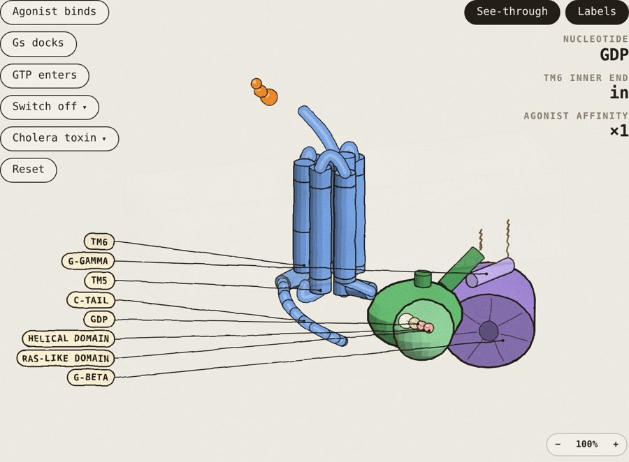
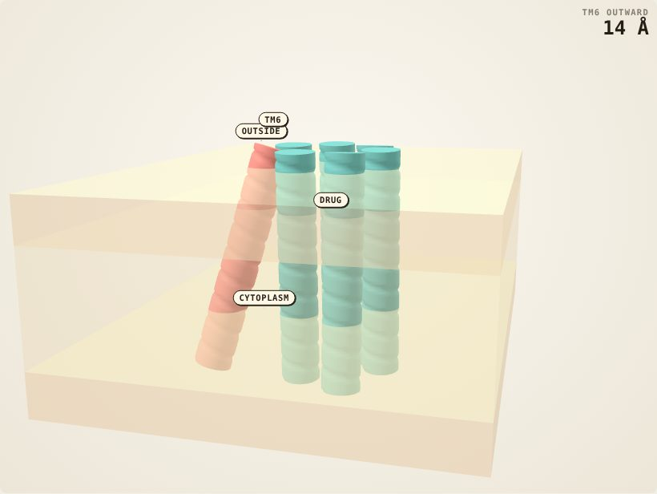
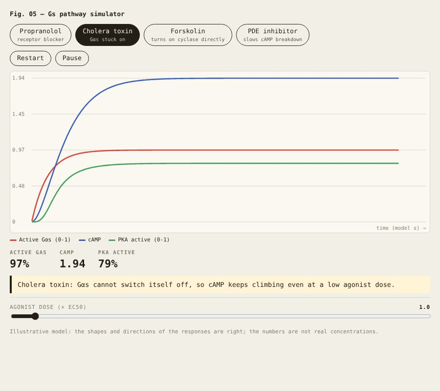
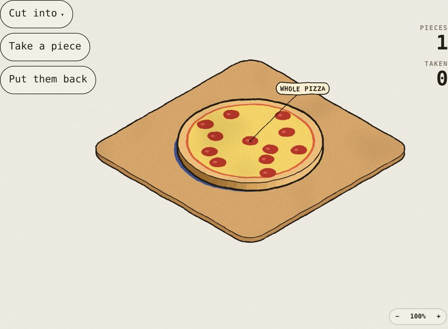
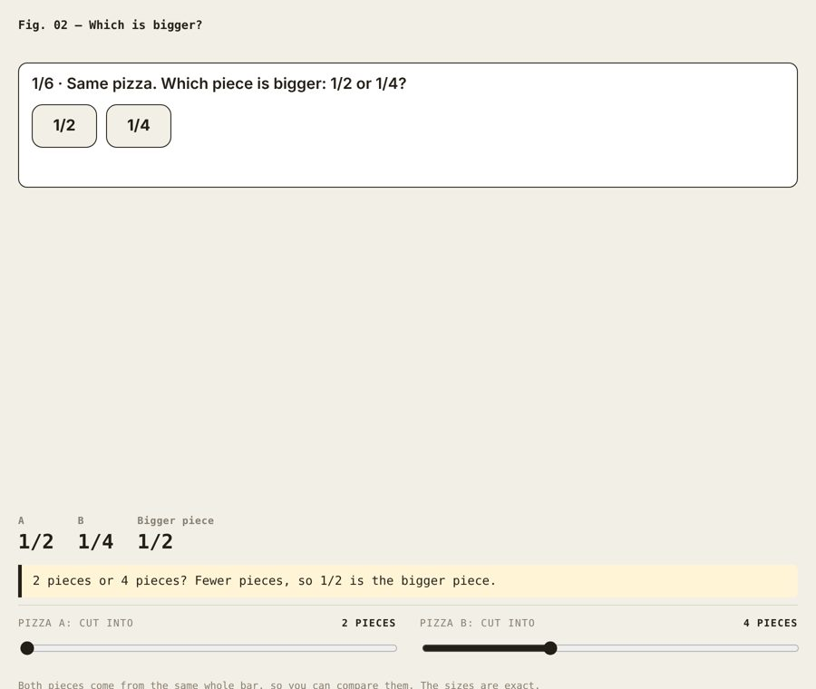
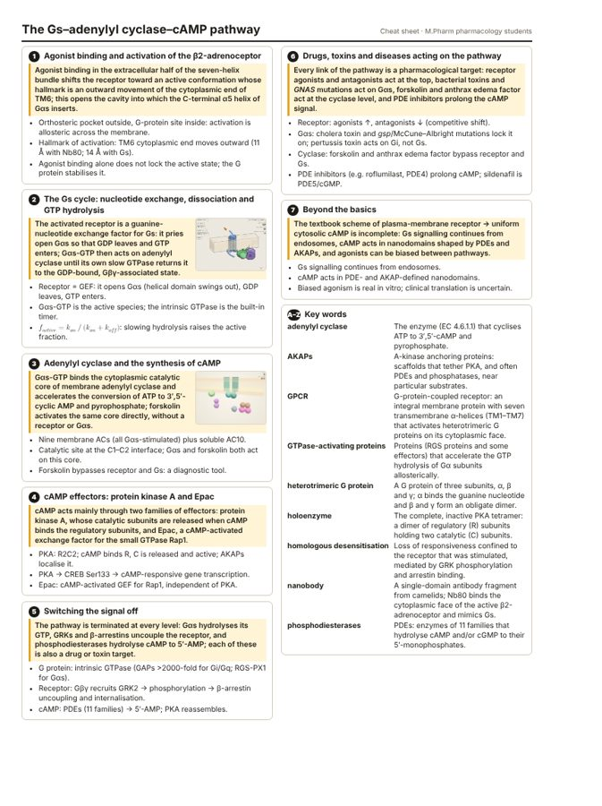

# learn3d-sim: a Claude skill for 3D, simulation-based, high-standard science notes

Evidence-based study notes on any science, maths, pharmacy or medical topic, written in the reader's register:
a child gets a story and a game; an undergraduate, postgraduate or PhD reader gets standard scientific prose with
nomenclature, equations and graded citations. Before writing, the skill confirms the level, scope and extras.

**Modules (used only when needed or asked for):** interactive 3D figures (Colorfigures for instruments and cell
scenes, smooth3d/three.js for molecules and anatomy, math3d for maths), a "what if" simulator or game, focus aids
for ADHD-like attention difficulties, and exports (editable doc, study page, PDF, one-page cheat sheet).

## Who it's for

| You are... | Ask, for example | You get |
|---|---|---|
| 🧒 **A child** (or the parent of one) | "My 8-year-old finds fractions hard, make something he can play with on the iPad" | A play page with big buttons, a 3D pizza to cut, a stars game, plus a short guide for the parent |
| 🎒 **A school student** | "Explain photosynthesis for my class 10 exam" | Clear notes with key terms, a 3D leaf/chloroplast model, practice questions, a one-page cheat sheet |
| 🎓 **An undergraduate** | "LC-MS/MS for drug screening, I'm final-year B.Pharm" | Textbook-style notes, a 3D instrument you can run, sourced numbers, a PDF |
| 🔬 **A postgraduate or PhD researcher** | "Gs pathway notes for M.Pharm, with 3D diagrams" | Review-article register, standard nomenclature, 30+ graded citations, "Beyond the basics" |
| ⚙️ **An engineer** | "How does a 4-stroke engine work, with the thermodynamics" · "Gears and torque for mechanical design" · "Op-amps for electronics" | Governing equations with units, a 3D machine with see-through parts, a worked design example, a simulator to vary the inputs |
| 🌌 **A curious adult, just for fun** | "How do black holes bend light?" · "Why is the sky blue?" · "How does a microwave oven heat food?" | Popular-science style: a hook, how we found out, true comparisons of scale, a 3D model to play with |
| 👩‍🏫 **A teacher** | "Lesson on electric circuits for 12-year-olds" | Class notes plus teacher boxes: common misconceptions, a demo, timing |
| 🧠 **Anyone who finds it hard to focus** | Add "I get distracted easily" or "I have ADHD" | Focus mode, short chunks, study timer, read-aloud, recall checks (only when asked) |

**Subjects:** biology, pharmacology and medicine · chemistry and lab methods · physics and astronomy · mechanical,
electrical, civil and chemical engineering · computing · maths, probability and statistics · earth and climate science.

| Hand-inked 3D (Colorfigures): β2 receptor and Gs, see-through with labels | Smooth 3D (three.js): agonist in the receptor pocket, TM6 swings out |
|---|---|
|  |  |
| **"What if" simulator**: switch drugs on and off, watch Gαs, cAMP and PKA | **For children**: a pizza to cut into equal pieces |
|  |  |
| **Game mode**: guess first, then see why, earn stars | **One-page cheat sheet**, made from the same notes |
|  |  |

## Install
- **Claude app:** download this repo as a zip (Code → Download ZIP), then Settings → Capabilities → Skills →
  Upload skill. The `learn3d-sim` folder must contain `SKILL.md` at its top level.
- **Claude Code:** copy the folder to `~/.claude/skills/learn3d-sim/`.

Then ask, for example: "Make M.Pharm notes on the Gs pathway with 3D figures."

## Layout
`SKILL.md` (core workflow) · `references/` (register by level, notes format) · `modules/` (research, 3D figures,
simulator, focus aids, exports) · `scripts/` (notes kit, figure builders, snapshot checker) · `assets/` (engines,
templates, examples) · `evals/` (test prompts and graders).

## Credits and licences
Colorfigures by April Zhu (MIT, https://april-zhu.com/colorfigures), see `assets/colorfigures/LICENSE`.
three.js r128 (MIT), see `assets/smooth3d/LICENSE-three.txt`.
